# Echoproof

[](https://github.com/est57/echoproof/actions/workflows/ci.yml)
[](https://github.com/est57/echoproof/releases)
[](#lisensi)

**Bahasa Indonesia** | [English](README.en.md)

**Verifikasi perilaku API untuk setiap perubahan kode, berdasarkan traffic nyata.**

Echoproof merekam request dan response asli dari service Anda, memutarnya ulang ke build hasil perubahan kode, lalu melaporkan **apa yang berubah, di endpoint dan field mana, pada berapa persen request, dan apakah perubahan itu memang diniatkan**. Hasilnya bisa dipakai sebagai gate di CI atau langsung oleh coding agent (Claude Code, Cursor, dan sejenisnya) untuk memeriksa pekerjaannya sendiri.

<p align="center"></p>

```
record  ->  replay ke build lama dan baru  ->  diff semantik  ->  nilai terhadap niat  ->  gate
```

## Daftar isi

- [Mengapa Echoproof](#mengapa-echoproof)
- [Fitur utama](#fitur-utama)
- [Instalasi](#instalasi)
- [Mulai cepat](#mulai-cepat)
- [Demo](#demo)
- [Konsep](#konsep)
- [Referensi perintah](#referensi-perintah)
- [Konfigurasi](#konfigurasi)
- [Membaca laporan](#membaca-laporan)
- [Integrasi CI](#integrasi-ci)
- [Integrasi coding agent (MCP)](#integrasi-coding-agent-mcp)
- [Keamanan dan privasi](#keamanan-dan-privasi)
- [Batasan](#batasan)
- [Pengembangan](#pengembangan)
- [Lisensi](#lisensi)

## Mengapa Echoproof

Saat sebagian besar kode ditulis oleh AI agent, jumlah perubahan naik jauh lebih cepat daripada kemampuan manusia untuk meninjaunya. Tes yang lulus dan diff yang tampak rapi belum menjamin perilaku sistem tetap benar, karena tes ditulis dari asumsi, sedangkan bug sering muncul dari kombinasi data nyata yang tidak terpikirkan.

Echoproof menjawab satu pertanyaan yang tidak dijawab oleh tes unit maupun code review:

> Apakah perubahan ini mengubah perilaku sistem terhadap traffic nyata, dan apakah perubahan itu memang yang dimaksud?

Contoh yang ditangkap Echoproof: sebuah PR berniat "menambah field `currency` di katalog", tetapi tanpa sengaja salah menempatkan satu argumen. Akibatnya harga 3 dari 8 menu berubah, sementara 5 menu lainnya tetap benar. Tes unit lulus dan diff kode terlihat wajar. Echoproof melaporkan `products[*].price: 18000 -> 22000` pada setiap request katalog dan menandainya sebagai regresi.

## Fitur utama

- **Rekam dari traffic nyata.** Reverse proxy yang merekam setiap request dan response, dengan data sensitif disamarkan sebelum ditulis ke disk.
- **Diff semantik.** JSON dibandingkan per field, bukan per baris teks. Perubahan dikelompokkan per endpoint dan field, lalu diklasifikasikan sebagai `breaking`, `behavior`, atau `additive`.
- **Tahan noise.** UUID, timestamp, dan nilai acak dikenali otomatis. Field yang berubah sendiri antar-run dipelajari dengan me-replay build lama dua kali.
- **Aman terhadap state.** Request tulis tidak di-replay kecuali diizinkan per endpoint. Build lama dan baru dibandingkan di atas data yang sama, dengan perintah reset di antara setiap putaran.
- **Sadar niat perubahan.** Setiap kelompok perubahan bisa dinilai oleh Claude terhadap deskripsi PR atau tugas agent. Perubahan yang tidak dijelaskan oleh niat ditandai sebagai regresi.
- **Siap untuk CI dan agent.** Exit code untuk gate merge, laporan Markdown untuk komentar PR, JSON untuk otomasi, dan server MCP untuk coding agent.

## Instalasi

**Kebutuhan:** Rust 1.85 atau lebih baru. `curl` diperlukan untuk menjalankan demo.

```bash
git clone https://github.com/est57/echoproof.git
cd echoproof
cargo install --path crates/echoproof-cli
```

Binary `echoproof` dipasang di `~/.cargo/bin`. Pastikan folder itu ada di `PATH`:

```bash
echo 'export PATH="$HOME/.cargo/bin:$PATH"' >> ~/.zshrc && source ~/.zshrc
```

```bash
echoproof --version
```

## Mulai cepat

Langkah berikut memeriksa sebuah perubahan kode pada service yang berjalan di lingkungan uji Anda.

**1. Buat file konfigurasi** (opsional, semua pengaturan punya nilai default):

```bash
echoproof init
```

**2. Rekam traffic.** Jalankan proxy di depan service, lalu arahkan aplikasi, Postman, atau tes otomatis ke alamat proxy:

```bash
echoproof record --upstream http://127.0.0.1:8000 --listen 127.0.0.1:8080 --out traffic.jsonl
```

Hentikan dengan `Ctrl-C` setelah traffic yang representatif terkumpul.

**3. Jalankan dua build**, versi sebelum perubahan (base) dan sesudahnya (PR), memakai database yang sama.

**4. Bandingkan:**

```bash
echoproof check -s traffic.jsonl --base http://127.0.0.1:8001 -t http://127.0.0.1:8002
```

**5. Baca hasilnya.** Exit code `0` berarti tidak ada perubahan yang tidak diharapkan, `1` berarti ada regresi, `2` berarti terjadi error. Lihat [Membaca laporan](#membaca-laporan).

Untuk menilai perubahan terhadap niatnya, tambahkan deskripsi PR dan diff kodenya:

```bash
git diff main...HEAD > change.diff
echoproof check -s traffic.jsonl --base http://127.0.0.1:8001 -t http://127.0.0.1:8002 \
  --intent-file pr-description.md --code-diff change.diff --output echoproof-report.md
```

## Demo

Demo lengkap berjalan sekitar 10 detik dan tidak membutuhkan service Anda sendiri:

```bash
./scripts/demo.sh
```

Demo memakai backend POS kecil (`examples/demo-shop`) yang memiliki state, yaitu stok produk yang berkurang setiap ada order. Sebuah "PR dari agent" berniat menambah field `currency` pada produk, tetapi juga mengubah cara diskon promo dan voucher digabungkan.

| Langkah | Yang ditunjukkan |
|---|---|
| 1. Rekam 2.000 request dari versi production | Proses perekaman |
| 2. Replay ke versi yang sama, dibandingkan dengan rekaman | Alarm palsu akibat state: stok sudah berkurang selama perekaman |
| 3. Bandingkan build base dan PR dengan `--base` dan `--reset`, mode aman | Alarm palsu hilang. `currency` terdeteksi. Request tulis dilaporkan belum terverifikasi |
| 4. Sama seperti langkah 3, dengan `--allow-writes "POST /orders"` | Bug diskon tertangkap, hanya pada order yang memakai promo dan voucher bersamaan |
| 5. Penilaian niat oleh Claude (jika `ANTHROPIC_API_KEY` tersedia) | `currency` dinilai intended, perubahan diskon dinilai regression |

## Konsep

### Snapshot

Snapshot adalah file JSONL berisi satu pasangan request dan response per baris. Header dan field sensitif sudah disamarkan sebelum ditulis. Snapshot yang sama dapat dipakai berulang kali untuk memeriksa banyak PR.

### Dua mode perbandingan

| Mode | Perintah | Cocok untuk |
|---|---|---|
| Terhadap rekaman | `echoproof check -s traffic.jsonl -t URL_PR` | Service tanpa state, atau lingkungan yang datanya identik dengan saat perekaman |
| Base vs PR | `echoproof check -s traffic.jsonl --base URL_BASE -t URL_PR` | Service dengan database (disarankan) |

Pada mode **base vs PR**, response hasil rekaman tidak dipakai sebagai acuan. Echoproof memutar traffic yang sama ke kedua build di atas data yang sama:

```
reset  ->  replay ke base         ->  acuan
reset  ->  replay ke base lagi    ->  field yang berbeda dicatat sebagai noise
reset  ->  replay ke PR           ->  kandidat
diff acuan dan kandidat, abaikan noise
```

Alamat server masing-masing build (misalnya `http://127.0.0.1:8001` di URL gambar atau link pagination) dinormalkan otomatis, sehingga dua build yang berjalan di port berbeda tetap sebanding.

### Mode aman

Secara default, hanya method `GET`, `HEAD`, dan `OPTIONS` yang di-replay. Request tulis dilewati dan **tidak dihitung lulus**: laporan menyebut jumlahnya dan memperingatkan bahwa perilakunya belum terverifikasi.

Izinkan request tulis per endpoint, hanya terhadap lingkungan yang boleh diubah atau dapat di-reset:

```bash
echoproof check ... --allow-writes "POST /orders" --allow-writes "PUT /cart/*"
```

Gunakan `--reset` (atau `replay.reset`) untuk mengembalikan state sebelum setiap putaran, misalnya dengan me-restore dump database atau memanggil endpoint reset di lingkungan uji. Echoproof menolak me-replay request tulis tanpa reset bila noise sedang dipelajari, karena perubahan state di antara run akan ikut dianggap noise dan menyembunyikan regresi.

### Diff semantik

- JSON dibandingkan per field. `5` dan `5.0` dianggap sama, dan urutan key diabaikan.
- Setiap perubahan diklasifikasikan:

  | Klasifikasi | Contoh |
  |---|---|
  | `breaking` | Field hilang, tipe berubah (termasuk menjadi `null`), status 2xx menjadi error |
  | `behavior` | Nilai berubah, panjang array berubah, status berubah |
  | `additive` | Field baru |

- Path dinormalkan: `/products/42` menjadi `GET /products/{id}`, dan `items[3].price` menjadi `$.items[*].price`. Setiap perubahan dihitung sekali per request.
- UUID, ULID, dan date-time dengan bentuk yang sama dianggap noise. Tanggal saja (misalnya `2026-10-14`) tetap dibandingkan.

### Niat perubahan

Ada dua cara memberi tahu Echoproof perubahan apa yang diharapkan.

| Cara | Tingkat | Kapan dipakai |
|---|---|---|
| `--expect "GET /products/*"` | Endpoint | Cepat, gratis, tanpa layanan eksternal |
| `--intent "..."` | Endpoint, field, dan nilai | Saat perubahan yang diharapkan dan bug bisa terjadi di endpoint yang sama |

`--expect` meloloskan semua perubahan di endpoint yang disebut. Jika sebuah PR memang mengubah katalog tetapi tanpa sengaja juga merusak harga di katalog, `--expect "GET /catalog"` tidak akan menangkapnya.

Dengan `--intent`, setiap kelompok perubahan dinilai oleh Claude dan diberi verdict `intended`, `regression`, atau `unclear`, beserta alasan yang mengutip nilai contoh. Bahan penilaiannya meliputi niat perubahan, diff kode (opsional), persentase request yang terdampak, contoh request yang berubah beserta nilai sebelum dan sesudah, serta contoh request di endpoint yang sama yang tidak berubah sebagai pembanding. Verdict `unclear` dan kelompok yang tidak dinilai diperlakukan sebagai regresi (fail closed).

Penilaian niat membutuhkan API key Anthropic. Satu run melakukan satu panggilan API, dan hanya jika ada perubahan. Biaya tipikal sekitar USD 0,01 sampai 0,02 per run dengan model default.

## Referensi perintah

| Perintah | Fungsi |
|---|---|
| `echoproof init` | Membuat `echoproof.toml` beserta penjelasan setiap pengaturan |
| `echoproof record --upstream URL --out FILE` | Menjalankan reverse proxy yang merekam traffic |
| `echoproof replay -s FILE -t URL -o FILE` | Me-replay snapshot ke target dan menyimpan response-nya |
| `echoproof diff BASELINE CANDIDATE` | Membandingkan dua snapshot |
| `echoproof check -s FILE -t URL` | Replay dan diff dalam satu langkah, terhadap rekaman |
| `echoproof check -s FILE --base URL -t URL` | Replay dan diff, base vs PR pada state yang sama |
| `echoproof accept CANDIDATE --baseline FILE` | Menjadikan response yang sudah ditinjau sebagai baseline baru |
| `echoproof mcp` | Menjalankan server MCP untuk coding agent |

Opsi umum:

| Opsi | Berlaku untuk | Keterangan |
|---|---|---|
| `--config FILE` | semua | File konfigurasi, default `echoproof.toml` |
| `--expect PATTERN` | `diff`, `check` | Endpoint yang diharapkan berubah. Dapat diulang |
| `--intent TEXT`, `--intent-file FILE` | `diff`, `check` | Niat perubahan untuk dinilai oleh Claude |
| `--code-diff FILE` | `diff`, `check` | Diff kode sebagai bahan penilaian niat |
| `--format text\|markdown\|json` | `diff`, `check` | Format output ke terminal, default `text` |
| `--output FILE` | `diff`, `check` | Menyimpan laporan. Format mengikuti ekstensi (`.md`, `.json`) |
| `--max-examples N` | `diff`, `check` | Jumlah contoh per kelompok perubahan, default 2 |
| `--base URL` | `check` | Build acuan untuk mode base vs PR |
| `--reset CMD` | `check` | Perintah shell untuk mengembalikan state sebelum setiap putaran |
| `--noise-runs N` | `check` | Jumlah replay tambahan ke base untuk mempelajari noise, default 1 |
| `--allow-writes PATTERN` | `replay`, `check` | Endpoint yang request tulisnya boleh di-replay. Dapat diulang |
| `--concurrency N` | `replay`, `check` | Jumlah request paralel, default 1 |
| `--save FILE` | `check` | Menyimpan snapshot kandidat |

Pola endpoint: `POST /orders`, `GET /products/*` (`*` cocok dengan satu segmen), `/admin/**` (`**` cocok dengan banyak segmen), atau `*` untuk semua.

**Exit code:** `0` lulus atau hanya perubahan yang diharapkan, `1` ada regresi, `2` error (konfigurasi, jaringan, reset gagal, atau penilaian niat gagal).

## Konfigurasi

Semua pengaturan bersifat opsional. Jalankan `echoproof init` untuk membuat file berisi seluruh pengaturan beserta penjelasannya.

```toml
[record]
upstream = "http://127.0.0.1:8000"
listen = "127.0.0.1:8080"

[sanitize]
# Diterapkan saat merekam dan saat replay, sehingga nilai yang disamarkan tetap sebanding.
redact_headers = ["authorization", "cookie", "set-cookie", "x-api-key"]
redact_fields = ["password", "token", "pin", "card_number", "phone", "email"]

[replay]
concurrency = 1                                          # naikkan hanya untuk endpoint tanpa state
timeout_ms = 10000
headers = { authorization = "Bearer ${STAGING_TOKEN}" }  # menggantikan header yang disamarkan
safe_methods = ["GET", "HEAD", "OPTIONS"]
allow_writes = ["POST /orders"]                          # default kosong (mode aman)
reset = "./scripts/restore-test-db.sh"
noise_runs = 1

[diff]
ignore = ["updated_at", "$.meta.trace_id", "items[*].etag"]
expect = ["GET /products/*"]
auto_noise = true
compare_headers = ["content-type"]

[judge]
model = "claude-opus-5-5"
effort = "high"                                          # low, medium, high, xhigh, max
fallbacks = true

[mcp]
allowed_hosts = []                                       # host selain localhost yang boleh dipakai agent
```

Pola `ignore`: nama saja (`updated_at`) cocok di kedalaman mana pun. Pola yang diawali `$` atau mengandung titik (`$.meta.trace_id`, `items[*].etag`) dihitung dari akar body.

**Variabel lingkungan:**

| Variabel | Keterangan |
|---|---|
| `ANTHROPIC_API_KEY` | API key untuk penilaian niat (alternatif: `ANTHROPIC_AUTH_TOKEN`) |
| `ANTHROPIC_WORKSPACE_ID` | Wajib jika API key tidak terikat ke satu workspace |
| `ANTHROPIC_BASE_URL` | Endpoint API alternatif. Harus `https`, kecuali `localhost` |
| `ECHOPROOF_JUDGE_TRACE` | Menyimpan request dan response penilai ke file (izin `0600`) untuk debugging |

## Membaca laporan

Contoh laporan di terminal:

```
echoproof: REGRESSION - 83 exchanges, 5 changed, 78 unchanged
  ignored 1 noisy fields that differ between runs of the base build: GET /up body
  intent judged by claude-opus-5-5: The currency field is added as intended. ...

  x GET /catalog                5/5 changed (100.0%)  unexpected
      behavior  value changed   $.result.products[*].price  (5 requests)
          [regression] The diff swaps the third argument of products() ...
          GET /catalog  [00e36fd43ade]
            $.result.products[1].price: 18000 -> 22000
      additive  added           $.result.currency  (5 requests)
          [intended] Adding 'currency' => 'IDR' matches the intent.

  - GET /branches               0/5 changed (0.0%)  unchanged

result: FAIL
```

| Tanda | Arti |
|---|---|
| `x` | Endpoint berubah dengan cara yang tidak diharapkan (regresi) |
| `~` | Endpoint berubah sesuai harapan atau niat |
| `-` | Endpoint tidak berubah, atau request-nya tidak di-replay |
| `(N requests)` | Jumlah request yang mengalami perubahan tersebut |
| `[intended]`, `[regression]`, `[unclear]` | Verdict penilaian niat beserta alasannya |

Format lain:

- `--format markdown` menghasilkan laporan yang siap dipakai sebagai komentar PR.
- `--format json` menghasilkan data terstruktur, termasuk `findings`: satu kalimat per masalah yang siap dikembalikan ke coding agent.

Setelah perubahan ditinjau dan disetujui, jadikan hasilnya baseline baru:

```bash
echoproof replay -s traffic.jsonl -t URL_PR -o candidate.jsonl
echoproof accept candidate.jsonl --baseline traffic.jsonl
```

## Integrasi CI

Contoh langkah di GitHub Actions:

```yaml
- name: Install Echoproof
  run: cargo install --git https://github.com/est57/echoproof echoproof

- name: Start base and PR builds
  run: ./scripts/start-builds.sh   # base di :8001, PR di :8002, database uji yang sama

- name: Behavior check
  env:
    ANTHROPIC_API_KEY: ${{ secrets.ANTHROPIC_API_KEY }}
  run: |
    echo "${{ github.event.pull_request.body }}" > pr.md
    git diff origin/${{ github.base_ref }}...HEAD > change.diff
    echoproof check -s traffic/baseline.jsonl --base http://127.0.0.1:8001 -t http://127.0.0.1:8002 \
      --reset ./scripts/reset-db.sh --intent-file pr.md --code-diff change.diff --output echoproof.md

- name: Comment on PR
  if: always()
  run: gh pr comment ${{ github.event.number }} --body-file echoproof.md
```

Exit code `1` menggagalkan job dan memblokir merge.

## Integrasi coding agent (MCP)

`echoproof mcp` menjalankan server [Model Context Protocol](https://modelcontextprotocol.io) melalui stdio, sehingga coding agent dapat memeriksa perubahan yang dibuatnya sendiri sebelum menyatakan pekerjaan selesai.

**Claude Code** (jalankan dari root proyek yang berisi snapshot):

```bash
claude mcp add echoproof -- echoproof mcp
```

**Klien lain** (`.mcp.json`):

```json
{ "mcpServers": { "echoproof": { "command": "echoproof", "args": ["mcp"] } } }
```

| Tool | Input utama | Fungsi |
|---|---|---|
| `echoproof_check` | `snapshot`, `target`, `base`, `intent`, `expect`, `allow_writes` | Replay dan diff. Mengembalikan laporan untuk agent, JSON terstruktur, dan `run_id` |
| `echoproof_diff` | `baseline`, `candidate`, `intent`, `expect` | Membandingkan dua snapshot yang sudah ada |
| `echoproof_exchange` | `run_id`, `id` | Request lengkap, response acuan dan kandidat, serta perubahan per field |

Alur kerja agent: mengubah kode, menjalankan build, memanggil `echoproof_check` dengan tugasnya sebagai `intent`, lalu jika hasilnya regresi, membuka contoh dengan `echoproof_exchange`, memperbaiki kode, dan memeriksa ulang. Server sengaja tidak menyediakan `accept`, karena menyetujui baseline baru tetap keputusan manusia.

## Keamanan dan privasi

**Data yang direkam**

- Header dan field yang terdaftar di `[sanitize]` disamarkan menjadi `[REDACTED]` sebelum ditulis ke disk. Tambahkan field yang memuat data pribadi di domain Anda, misalnya nomor telepon, email, atau nomor identitas.
- Snapshot berisi data bisnis. Simpan di luar repository publik atau pastikan masuk `.gitignore`.

**Data yang dikirim ke Anthropic saat memakai `--intent`**

Teks niat, diff kode (jika diberikan), nama endpoint dan field, jumlah request yang terdampak, serta contoh body request dan nilai sebelum dan sesudah, setelah disamarkan. Body contoh di atas 4.000 karakter dipotong. Tidak ada data yang dikirim jika `--intent` tidak dipakai.

**Pengaman bawaan**

- Request tulis tidak di-replay tanpa izin eksplisit per endpoint.
- Path dari snapshot divalidasi agar request dan kredensial yang disisipkan tidak dapat diarahkan ke host lain.
- Response dibatasi 32 MB.
- API key hanya dikirim melalui `https`, kecuali ke `localhost`.
- Teks dari luar (niat, diff, traffic) tidak dapat mengubah struktur prompt penilai, dan tidak dapat merusak tabel di laporan Markdown.

**Pengaman untuk coding agent (MCP)**

- `target` dan `base` hanya boleh `localhost`, kecuali host didaftarkan di `[mcp] allowed_hosts`. Replay membawa header dari `replay.headers`, sehingga agent tidak boleh dapat mengirimnya ke host lain.
- Path file (`snapshot`, `save`, `code_diff_file`) harus berada di dalam folder proyek. Symlink ke luar folder ditolak.
- Perintah reset hanya dibaca dari `echoproof.toml`, tidak pernah dari agent.

## Batasan

- **Request tulis** membutuhkan lingkungan uji yang dapat di-reset. Tanpa itu, gunakan mode aman, yang hanya memverifikasi request baca.
- **Dependency eksternal** seperti payment gateway, SMS, atau API pihak ketiga belum di-mock. Build base dan PR sama-sama memanggilnya saat replay.
- **ID antar-request** belum dipetakan. Request rekaman seperti `GET /orders/123` mungkin merujuk data yang tidak ada di lingkungan uji.
- **Urutan request** dijaga dengan replay berurutan (`concurrency = 1`). Traffic besar bisa lambat, dan replay paralel hanya aman untuk endpoint tanpa state.
- **Perubahan yang seharusnya terjadi tetapi tidak terjadi** sulit dideteksi, karena Echoproof melaporkan request yang berubah.
- **Noise yang jarang muncul** dapat lolos dari satu run pembelajaran. Naikkan `--noise-runs` atau tambahkan pola `ignore` bila perlu.

## Pengembangan

**Struktur repository**

```
crates/echoproof-core     format snapshot, sanitasi, diff, laporan, penilaian niat
crates/echoproof-cli      binary `echoproof`: perekam, replay, CLI, server MCP
examples/demo-shop     backend POS untuk demo dan eval
eval/judge             eval penilai niat: kasus uji, runner, dan grader
scripts/demo.sh        demo end-to-end
```

**Menjalankan tes**

```bash
cargo test
cargo clippy --all-targets -- -D warnings
```

**Eval penilai niat**

`eval/judge` berisi 26 skenario PR berlabel (54 kelompok perubahan) yang mengukur seberapa akurat penilai membedakan perubahan yang diniatkan dari regresi. Pada konfigurasi default, penilai mencatat 100% gate benar pada 78 run, tanpa false alarm. Skenario saat ini sudah tidak cukup sulit untuk membedakan konfigurasi yang lebih baik, sehingga kasus dari sistem nyata sedang ditambahkan. Daftar kasus ada di `eval/judge/CASES.md`.

```bash
eval/judge/prepare.sh                                                         # buat fixture, tanpa biaya API
node eval/judge/run-eval.mjs --flow eval/judge/runs/intent-judge --variant baseline --reps 3
node eval/judge/summarize.mjs eval/judge/runs/intent-judge/baseline
```

Runner menolak berjalan sampai harness disetujui sekali dengan `--approve-harness`, dan meminta persetujuan ulang setiap kali kode runner, kasus, atau penilai berubah.

## Lisensi

Echoproof dilisensikan di bawah salah satu dari dua lisensi berikut, sesuai pilihan Anda:

- Apache License, Version 2.0 ([LICENSE-APACHE](LICENSE-APACHE))
- MIT License ([LICENSE-MIT](LICENSE-MIT))

Kecuali dinyatakan lain, setiap kontribusi yang Anda kirimkan untuk disertakan dalam proyek ini dilisensikan ganda dengan cara yang sama, tanpa syarat tambahan.
